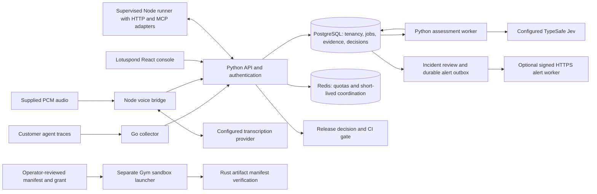

# ADR-0002: Recover the assurance platform with a Python core

Date: 2026-09-21. Status: implementing. Supersedes ADR-0001's source-reuse restriction and TypeScript-primary decision under the current product goal.

## Product flow

A developer signs up and receives a personal workspace. Creating an organization is a deliberate action that grants its creator owner membership. Both workspace types contain projects; agents, scenarios, production streams, policies, and releases belong to a project or its owning workspace. Platform administration is a separate operator privilege, never granted by public signup or an organization role.

## Boundaries

- Python owns identity, access, relational data, runs, policies, monitoring, voice sessions, evaluations, administration, and workspace budget settings. A modular service minimizes deployment and consistency costs during the two-day build window.
- Go is the bounded telemetry ingestion edge, with backpressure and explicit upstream authentication. Rust handles deterministic artifact integrity. Node remains useful for the UI toolchain and JavaScript protocol/client workloads; it is not another competing control plane.
- PostgreSQL stores durable work and immutable evidence. Redis handles distributed limits. Evaluation/model calls occur outside database transactions and fail to an unknown result, never a successful release verdict.
- Deterministic policy and human authorization remain authoritative. Jev supplies semantic judgments with model provenance; it cannot grant tool permissions or silently approve a release.
- Voice is a modality of scenarios, runs, live sessions, evidence, and gates. Transcript revisions carry timestamps and finality. Audio-dependent metrics require audio evidence and are never inferred from transcript-only input.
- Sandbox definitions are pinned external supply-chain inputs. Execution belongs in restricted workers with a lifecycle, scoped secrets, network policy, resource limits, and teardown. Importing a catalogue alone is not sandbox validation.

The Gym launcher and Rust artifact CLI are separately operated tools; they are not automatically invoked by the Python assessment worker. The baseline upstream local Gym runner provides synthetic observations. A separate pinned X11 terminal task runs a genuine application with independent state checks. Its operator-managed loopback agent protocol accepts bounded observations/actions, and a Node adapter returns the resulting receipt through the existing leased-run contract. Wider software environments, representative customer agents, attested image supply, and an offline semantic evaluator remain integration work.

## Data and deployment transition

Define a new Python-owned database baseline and initialize it only in a separately verified empty local development database. The former local database remains untouched; the transitional TypeScript service was externally archived after Python workflow validation. Do not replace their records or retrofit the old schema by dropping tables. Production changes require an explicit reviewed migration/cutover plan and live evidence.

Hosted and on-prem deployments use the same services. Air-gap mode disables external calls and ships pinned images/packages plus a checked manifest. Availability of a cloud evaluator does not imply its model weights can be redistributed or run offline; document that distinction and require a locally available evaluator for offline semantic judgments.

## Recovery and readiness

Recover relevant implementation from the local archive without copying credentials, obsolete affiliations, deployment consumers, or history. Track restored behaviors and validation. The comprehensive acceptance register is `docs/GOAL.md`; it remains open until every requested outcome is proven.
