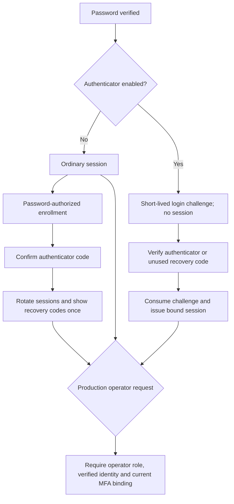

# 0004 — Authenticator MFA and session strength

Date: 2026-09-21. Scope: browser identity and production platform administration. Organization-wide MFA policies, federation, passkeys and assisted recovery are outside this decision.

## Required behavior

Password-only access must not reach an account with an enabled second factor. A production platform operator may sign in to enroll but must confirm authenticator possession before accessing operator endpoints. Email or offline identity verification establishes the separate identity claim; neither elevates session authentication strength.

Use a six-digit, 30-second TOTP authenticator with a narrowly bounded clock window. Rely on the existing `cryptography` implementation. Encrypt secrets with AES-GCM using a dedicated operator-managed key and associated data binding the ciphertext to its user and factor. Store only digests for high-entropy challenge and recovery tokens. Keep secrets and responses out of logs, browser storage and cache.

## Flow and authority

MFA verification is bound to a factor generation and recorded on the session. Existing sessions are never backfilled as MFA-verified during migration. Enabling, disabling or regenerating recovery material revokes prior sessions; stale factor bindings cannot survive a lifecycle change. Login and MFA mutation operations serialize on the user row, followed by the related factor/challenge rows. Successful TOTP verification advances a replay counter, and recovery-code consumption and session issuance occur in one transaction.

The login challenge expires, has a durable attempt cap and does not grant workspace access. Shared production rate limits complement its database state. Failed attempts must be committed without issuing a session. Password recovery revokes outstanding sessions/challenges but leaves the enrolled authenticator intact. Changing a password must preserve legitimate MFA strength without elevating an ordinary session.

Enrollment is provisional until the person supplies a valid code. Starting setup verifies the password and revokes/rotates prior sessions, so an older session cannot complete another browser's password-authorized setup. Recovery codes are generated once, hashed for storage and presented only in the successful confirmation/regeneration response. Factor changes require both the password and a fresh enrolled factor or unused recovery code. Production operators cannot disable MFA. There is no email, administrator or offline CLI override for a lost authenticator and lost recovery codes.

## Persistence and deployment

Schema 8 is additive: new MFA records plus nullable session binding fields. Prior identity and business data remains unchanged. The migration must reject unexpected partial schemas and roll back completely on failure. Local migration follows an independently verified loopback database, backup and row-preservation proof; it is not a production migration tool.

Only API instances need the encryption key. All must resolve the same stable value. Database backups and a separately protected key backup are both needed for factor recovery. Removing configuration cannot downgrade an enabled account to password-only access. Changing the key without a reviewed re-encryption process is unsupported. No key is packaged in a deployment image or offline archive.

## Evidence and limits

Validation must cover RFC vectors, code replay and concurrent consumption, enrollment expiration, challenge exhaustion, password recovery, session rotation, revoked identities, factor binding, missing-key behavior and production-operator enforcement. Browser checks must cover both sign-in phases, one-time recovery material, readable errors and no persistent secret storage. The offline installation drill exercises a real production-mode operator enrollment and MFA sign-in in disposable containers. See [the validation record](../VALIDATION.md) for completed evidence.

TOTP is phishable. This design does not claim phishing resistance, regulatory compliance, hardware protection of keys, out-of-band change notifications or human identity proofing. It deliberately provides no automatic recovery downgrade. Future passkeys/federation and reviewed assisted recovery require their own lifecycle design.

References: [RFC 6238](https://datatracker.ietf.org/doc/html/rfc6238), [cryptography TOTP](https://cryptography.io/en/latest/hazmat/primitives/twofactor/), [OWASP MFA guidance](https://cheatsheetseries.owasp.org/cheatsheets/Multifactor_Authentication_Cheat_Sheet.html), reviewed 2026-09-21.
