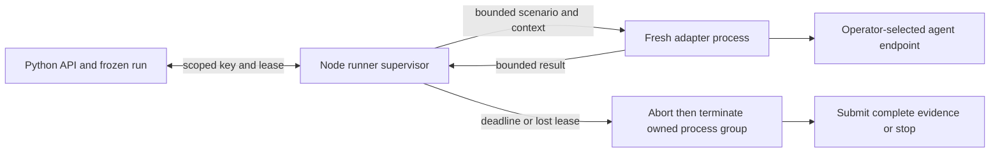

# 0006: Supervised customer evaluation execution

Status: accepted, 2026-09-21.

The runner's previous in-process timeout depended on the adapter yielding to Node's event loop and honoring an AbortSignal. A CPU loop could block both the deadline and lease renewal. An asynchronous adapter could continue work after the runner had recorded an inconclusive result. This did not provide a reliable execution boundary.

The control process now owns the API credential, lease renewal and result submission. Each scenario uses a fresh child process with bounded JSON input/output, a parent-enforced deadline, cooperative abort and bounded process-group termination. Only scenario input, expectations, revision and run/scenario identifiers cross the input boundary. The adapter receives explicitly allowed environment values; control-plane credentials and Node loader configuration are excluded. Raw adapter stdout and stderr never become operator logs or API errors.

This bounds the lifecycle of trusted, operator-selected adapters on POSIX hosts. It does not sandbox hostile code, remove filesystem access, stop escaped process groups, or cancel a request already executing on a remote service. Adapters that create external resources still need their own teardown and evidence. The reviewed Gym adapter retains its independent container cleanup receipt; generic process cleanup cannot substitute for it.

Lease renewal runs independently of adapter execution. Cancellation, revoked authorization, lost leases and renewal failures stop active work and suppress result submission. The server remains authoritative: results require a live lease and exactly one entry per frozen scenario, and terminal state cannot be overwritten. No automatic retry of an ambiguous result submission is introduced.

New frozen snapshots have a 4 MiB canonical UTF-8 bound. Runner capabilities are evaluated in SQL before row locking, so incompatible older work cannot hide compatible work. The client bounds requests to 2 MiB and responses to 8 MiB. Complete result batches that cannot fit are inconclusive rather than truncated into successful evidence. These limits do not provide streaming artifacts or unlimited scenario packs.

The recovered HTTP adapter preserves useful plain-input/OpenAI-style request mapping and response-path extraction from the separately archived service. Its new transport retains the deadline through DNS and response consumption, bounds all evidence, and keeps infrastructure failures distinct from failed assertions. Destinations and authentication are operator configuration. Live customer/provider behavior remains a separate acceptance requirement.

Node documents [detached process groups and subprocess lifecycle](https://nodejs.org/api/child_process.html#optionsdetached); killing a process alone is not proof that its descendants or external resources are gone. Revisit this design for hostile adapters, Windows job objects, distributed execution, durable artifact storage, or production-volume workloads.
