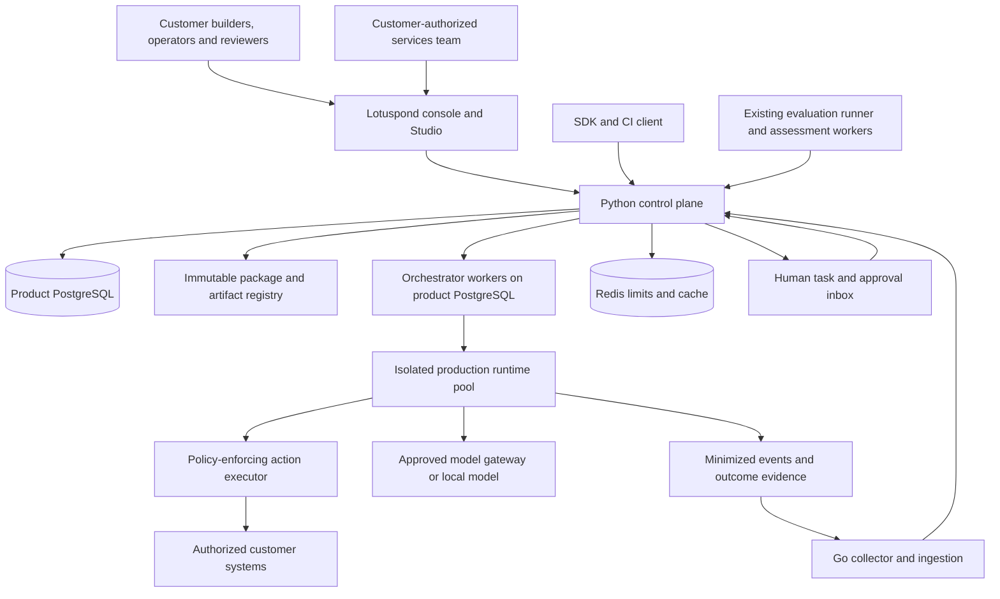

# Lotuspond platform architecture proposal

Date: 13 October 2026. Status: proposed target architecture. Companion to the [master plan](2026-10-13-platform-master-plan.md) and [delivery plan](2026-10-13-platform-delivery.md). Existing product behavior remains governed by current source and accepted ADRs until implementation updates them.

## 1. Architectural decisions

1. Keep one modular Python control-plane application and one React console. Extract services only for execution isolation, independent scaling or demonstrated team/operational ownership.
2. Add a separately deployed production runtime. Preserve the existing supervised evaluation runner and its contracts.
3. Own a versioned Lotuspond workflow/package format, public API, connector/action contract, product UX, authorization and business outcome model.
4. Own durable orchestration as a PostgreSQL-backed state machine behind a narrow adapter ([ADR-0011](../architecture/0011-postgresql-durable-execution.md), confirmed by the owner on 22 October 2026). This supersedes the original recommendation of Temporal with its Python SDK, subject to a spike; Temporal remains the named fallback behind the same adapter.
5. Start with one qualified deployment topology and one production worker environment. Support broader topologies through explicit qualification, not configuration flags alone.
6. Keep customer code and credentials outside the shared API process. Per-customer execution isolation is the initial hosted boundary; hostile shared execution is a later architecture program.

Superseded by ADR-0011 and retained for context: Temporal documents replayable workflow history, deterministic orchestration and external work in Activities. Its message-passing primitives support long waits for external decisions and its service can be self-hosted. These primitives reduce the need to invent timers, replay and recovery; they do not supply Lotuspond's authorization, isolation or business semantics. [Tasks](https://docs.temporal.io/tasks), [message passing](https://docs.temporal.io/encyclopedia/workflow-message-passing), [self-hosting](https://docs.temporal.io/self-hosted-guide).

Agent frameworks may run inside bounded agent activities. Use one supported framework initially, with an adapter contract. Do not introduce a second competing system of record for business execution state. Evaluate LangGraph or simpler model/tool loops for agent behavior; Lotuspond's external package and action contracts must remain independent of that choice.

## 2. Component and trust boundaries

Placement varies by deployment model. In particular, the orchestration history, model endpoint, artifact storage and support access must be included in data-residency decisions. A customer-local worker alone does not make the whole system local.

| Module                | Responsibility                                                                                               | Boundary                                                         |
| --------------------- | ------------------------------------------------------------------------------------------------------------ | ---------------------------------------------------------------- |
| Control plane         | Tenancy, definitions, registry, deployment admission, licensing, authorization, business records and UI APIs | No arbitrary customer code execution                             |
| Orchestration adapter | Start/signal/cancel commands, history projection, retries, timers and reconciliation                         | Narrow internal engine interface; no engine types in public API  |
| Runtime supervisor    | Worker identity, admission, package verification, task lifecycle and budgets                                 | Separate process/container/host with no platform-admin authority |
| Agent executor        | Bounded reasoning, model calls, structured outputs and proposed tool actions                                 | Treat prompts, retrieved text and tool output as untrusted data  |
| Action executor       | Enforce exact action permissions; resolve scoped secrets; perform and reconcile effects                      | Only reviewed connectors and permitted destinations              |
| Human work service    | Assignment, claim, expiry, decision, escalation and separation of duties                                     | Server-authorized decisions bound to exact reviewed material     |
| Assurance             | Existing tests, release gates, evidence, monitoring and incident review                                      | Evaluation cannot silently invoke production actions             |
| Artifact service      | Signed packages, documents, evidence, retention and export                                                   | Tenant-scoped encrypted storage; short-lived access              |

The product API and operator UI never expose the engine's administration interface to customer tenants. A queue or namespace label is a routing mechanism, not an authorization boundary.

## 3. Authoring and package contract

The Studio, SDK and AI-assisted authoring path produce the same declarative representation. The first editor supports a deliberate node vocabulary: trigger/input, transform, decision, connector read/write, agent, human task, timer, parallel branch, subworkflow and outcome verification. Validation rejects unbounded cycles, untyped connector calls and unavailable capabilities. Later features extend a versioned contract.

A released package contains:

| Group        | Required metadata                                                                                     |
| ------------ | ----------------------------------------------------------------------------------------------------- |
| Identity     | Package/version IDs, immutable digest, publisher and signatures                                       |
| Workflow     | Typed graph, inputs/outputs, node contracts, retry/timeout/compensation rules                         |
| Agents       | Instructions and hashes, model profile/configuration, structured output, allowed tools and escalation |
| Limits       | Step/iteration/time/token/spend limits, concurrency and resource needs                                |
| Dependencies | Connector/agent/subworkflow versions and exact artifact digests                                       |
| Context      | Knowledge source/version references, policy references and permitted data classifications             |
| Environment  | Runtime version/OS/architecture requirements, network permissions and credential reference names      |
| Assurance    | Evaluation suite version, business acceptance checks and evidence schema                              |

Secrets and private customer documents are not embedded in a package. Configuration is separately versioned per environment; a deployment records both package and configuration digests. The package importer must validate signatures, contract compatibility and required capabilities before installation.

A mutable draft can be edited; a published version cannot. Build/test and deployment receipts must reference the same candidate digest. New versions serve new executions by default. Existing executions stay pinned until completion or an explicitly tested migration. A visual edit must be diffable and reviewable just like code.

Document and knowledge ingestion needs source ACLs, version/freshness metadata, permitted retrieval scope, deletion propagation and citations. Begin with approved customer-supplied sources. A vector index, if needed, is derived data rather than a second ownership model; use the existing relational stack where adequate before adding specialist infrastructure.

## 4. Data and execution contracts

Preserve `Workspace → Project`; distinguish customer organizations from installation operators. Expand the current environment model deliberately rather than replacing its existing local/sandbox/production semantics without migration.

| Record family      | Proposed records                                                                 |
| ------------------ | -------------------------------------------------------------------------------- |
| Definitions        | AgentDefinition/AgentVersion, WorkflowDefinition/WorkflowVersion, PackageVersion |
| Connections        | ConnectorVersion, Connection, SecretReference, KnowledgeCollectionVersion        |
| Fleet              | ExecutionTarget, WorkerPool, RuntimeInstance, RuntimeCredential                  |
| Delivery           | Deployment, DeploymentReceipt, Trigger, Schedule, WorkQueue                      |
| Business execution | BusinessCase, Execution, StepAttempt, ExecutionEvent                             |
| Side effects       | ActionIntent, ActionDecision, ActionAttempt, ActionReceipt, ReconciliationTask   |
| Human work         | HumanTask, HumanDecision, assignment/escalation history                          |
| Evidence           | Artifact, OutcomeRecord, trace/execution/version links                           |
| Commercial/access  | LicenseGrant, UsageEvent, DelegatedAccessGrant, ServiceEngagementReference       |

Keep production `Execution` separate from evaluation `Run`. Existing release approvals and receipts are foundations; they do not yet establish a production runtime or downstream action verification.

Authority is explicit:

- Lotuspond PostgreSQL owns definitions, tenancy, authorization, deployment intent, business cases and action decisions.
- The orchestration engine owns durable workflow progression and its history; Lotuspond exposes a reconciled projection with event sequence/last-observed markers. Under ADR-0011 that engine is Lotuspond's own, and its progression and history are rows in product PostgreSQL.
- Customer systems own their business records. An agent's output is not their source of truth.
- Encrypted artifact storage owns retained large payloads; database records and engine events reference them. Secrets live in a supported secret store, not Redis, packages or event histories.
- Redis supports quotas/caching/short-lived coordination. It is not the authoritative execution queue or business ledger.

Use a transactional outbox to publish commands from committed Lotuspond state. Under ADR-0011 the engine shares that database, so the orchestrator consumes the outbox in the same transaction that applies it; the cross-store lost-response case below applies only to a replacement engine. Stable tenant-scoped execution IDs and inbox deduplication make repeated delivery safe. If a database commit succeeds but the engine response is lost, reconcile by that ID; never create a second business execution speculatively. Idempotent event projection resolves delayed or duplicated engine events. Document ordering and conflict behavior per event type.

Suggested additive API resources: `/api/v1/packages`, `/agents/{id}/versions`, `/workflows/{id}/versions`, `/connections`, `/runtime-pools`, `/deployments`, `/executions`, `/human-tasks`, `/action-intents`, `/outcomes`, `/licenses` and `/service-grants`. Final schemas require a contract ADR.

All mutating admission APIs use tenant-scoped idempotency keys with a request hash: same key/same payload returns the original result; same key/different payload conflicts. Async operations return an operation/execution ID, not a false completion. List APIs require bounded pagination. Webhooks require authentication, replay protection and deduplication. Scheduled triggers persist timezone, DST policy, misfire behavior and stable occurrence IDs; use Asia/Kolkata for owner-facing scheduled briefs.

Example production states: `accepted → queued → running → waiting_human/waiting_external → completed/failed/cancelled`; ambiguous effects enter `reconciliation_required`. Task attempts and business cases have separate state. Completion is not recorded until required outcome evidence is available.

## 5. Actions, approvals and failure behavior

The current `/authorize` route returns a policy verdict. Proposed production action execution must enforce it using real credential scope and network boundaries.

Each action authorization binds workspace/project, execution, package version, connector/tool, target, input digest, policy version and expiry. Approval binds the same material. If parameters change, approval is invalid. Check current revocation and emergency-denial state when admitting work and immediately before dispatching a consequential effect; previously admitted work does not retain unlimited authority. An already-dispatched external request cannot be recalled by a later revocation. Agents cannot authorize themselves or expand their capability sets.

For the initial connected runtime, loss of the authoritative control-plane authorization channel blocks new consequential effects. Preserve waiting state and bounded local evidence; reconnect and reauthorize before continuing. Do not silently allow cached approvals to bypass revocation. A later disconnected-operation mode would need explicitly bounded grants, a declared revocation-latency limit and a local emergency-denial mechanism. In a fully offline installation, the local control plane is the authorization authority; losing its connection follows the same fail-closed rule. Test disconnect plus revoke, including a request already in flight.

Use stable action IDs and target-supported idempotency keys. Where the target lacks idempotency, use read-back/reconciliation and domain keys where safe. A lock alone cannot guarantee exactly-once behavior in an external system. A timed-out request may already have succeeded; mark the result uncertain and reconcile before repeating. Fencing prevents stale workers from accepting new authority or committing Lotuspond state, but cannot revoke an already-sent external request.

| Failure                             | Required behavior                                                                                                              |
| ----------------------------------- | ------------------------------------------------------------------------------------------------------------------------------ |
| Duplicate trigger or event          | Reuse the accepted case/execution; do not repeat the tested external effect                                                    |
| Worker crash during a human wait    | Restore wait state and the exact reviewed action                                                                               |
| Network loss after a write          | Reconcile target state; preserve uncertainty until verified                                                                    |
| Model unavailable or invalid output | Bounded retry/fallback if allowed, otherwise human escalation or failure                                                       |
| Expired/revoked authorization       | Refuse new effects; preserve audit/evidence and expose recovery action                                                         |
| Stop/pause requested                | Stop future work at the defined boundary; acknowledge that completed effects remain                                            |
| Compensation required               | Execute explicit, authorized compensation; do not imply every action is reversible                                             |
| Deployment upgrade                  | Keep existing executions pinned; validate compatibility for new work                                                           |
| Incident replay                     | Use synthetic/test connections; never repeat live writes implicitly                                                            |
| Evidence storage unavailable        | Apply workflow risk policy; block consequential actions needing a pre-action record, retain bounded telemetry and report loss  |
| Capacity or license exhausted       | Apply disclosed admission/queue/grace behavior; do not discard accepted work silently                                          |
| Restore from an older backup        | Fence workers, invalidate prior execution authority, and reconcile external effects and current access before write resumption |

Before an external effect, durably record its intent and authorization. Afterwards, record observed receipt and verification separately. Audit records include actor, time, version and structured reason; avoid credentials, unnecessary private payloads or raw hidden model reasoning.

Recovery cannot undo customer-system writes or recover revocations that happened after a backup merely by restoring local data. Enter a fenced recovery mode, issue a new recovery epoch through an independently controlled authorization procedure, reconcile affected action IDs against authoritative systems, and revalidate restored identities/grants with current identity sources or the authorized customer administrator. Only then resume writes. Drill a backup restored from before an action that later succeeded and from before a user's access was revoked.

## 6. Identity, tenancy and runtime security

Extend existing human roles/MFA/scoped keys with runtime service identities and customer-approved service delegation. Distinguish license owner, security administrator, builder, operator, business reviewer, release approver and auditor. Platform operators manage infrastructure and receive no routine implicit access to customer evidence. Emergency access requires a separately designed, time-limited, justified and audited procedure.

Enterprise identity needs supported OIDC/SAML federation and provisioning/deprovisioning where required, tested session revocation and directory lifecycle behavior. Preserve existing MFA and offline identity semantics. Product and customer-workflow permissions must be enforced on the server; a UI role is insufficient.

Worker enrollment uses a one-use enrollment token exchanged for a short-lived identity, with rotation, revocation, signed commands, anti-replay and explicit workspace/pool capabilities. Resolve credentials at the execution boundary through scoped secret references. Connections declare allowed operations/destinations and data handling. No arbitrary URL or executable uploaded by a request reaches the shared API process.

Connector qualifications include supported auth and API versions, read/write capabilities, rate limits, schema mapping, test mode, idempotency, reconciliation, cleanup and credential rotation. Generic HTTP/MCP/A2A protocol support does not certify a business integration. UI/desktop workers need their own OS/session lifecycle, isolation and UI-change recovery qualification; the existing Linux evaluation subprocess is not a Windows automation agent.

Customer data handling covers documents, prompts, model providers, engine histories, object storage, embeddings, traces, backups and support exports. Minimize and redact at collection; configure retention and deletion consistently, with legal holds where required. Use payload references and encryption when sensitive workflow data could enter orchestration history. Temporal documents payload codec patterns for this purpose; implementation and key custody remain part of the deployment design. [Data encryption](https://docs.temporal.io/self-hosted-guide).

All schema changes require a reviewed additive migration plan, isolated localhost integration testing and backwards-compatible deployment sequencing. Planning does not authorize production database inspection or change.

## 7. Deployment modes and qualification

| Mode                                   | Placement                                                                                     | Qualification gate                                                                                              |
| -------------------------------------- | --------------------------------------------------------------------------------------------- | --------------------------------------------------------------------------------------------------------------- |
| Managed connected pilot                | One isolated customer installation/pool on managed infrastructure                             | Identity, TLS, secrets, monitoring, restore/upgrade and real workflow acceptance                                |
| Hosted control plane, customer runtime | Authenticated outbound connection from customer network; no unsolicited inbound worker access | Full map of metadata/payloads crossing the boundary, disconnection behavior and credential locality             |
| Customer-managed/BYOC                  | Control plane, engine, storage and workers in customer environment                            | Install/update contract, responsibility matrix, support access and compatibility tests                          |
| Air-gapped                             | Entire supported stack local, with approved local models/evaluators if offered                | Signed offline supply chain/license, no-egress tests, internal TLS, identity, clock and transfer/upgrade drills |
| Shared multi-tenant hosted runtime     | Future distinct isolation tier                                                                | Threat model, escape/isolation tests, resource fairness and operational proof before customer code is accepted  |

Recommended first supported production target: a connected, single-customer installation with one Linux API/action runtime pool. This reduces the first trust-boundary and operations matrix while preserving future deployment contracts. Confirm demand before committing the commercial edition to a topology.

Use the same versioned artifacts across environments, with installation-specific configuration. Docker Compose remains useful for development and bounded installation drills. A production topology must meet its demonstrated availability/recovery needs; Kubernetes is justified by fleet/isolation/operations needs, not by repository size. If AWS is selected, follow existing project profile/region guidance and inventory resources before any separately authorized infrastructure change.

Offline operation cannot rely on external transcription, hosted identity, cloud models or external billing validation. Local substitutes require separate compatibility and quality evidence. Customer-managed is not automatically air-gapped.

## 8. Reliability, scale and cost assumptions

The following are design/test hypotheses for the first supported topology, not achieved benchmarks or promised SLAs:

| Dimension     | Initial planning target                                                                                                     | Proof                                                                                                            |
| ------------- | --------------------------------------------------------------------------------------------------------------------------- | ---------------------------------------------------------------------------------------------------------------- |
| Workload      | Admission hypothesis of 5 new executions/second, 25 active external/model steps; separate 10,000-waiting-case recovery test | Use the bounded workload mix below; real end-to-end throughput depends on activity duration and customer systems |
| Admission API | p95 below 1 second at target load, excluding asynchronous model/business completion                                         | Measure API latency and rejected admissions separately                                                           |
| Availability  | 99.9% monthly control-plane availability target for a supported commercial tier                                             | 30-day observed SLI; dependency and end-to-end workflow failure tracked separately                               |
| Recovery      | RPO at most 15 minutes; RTO at most 4 hours for stated topology                                                             | Restore platform database, engine state, artifacts and keys coherently from backup                               |
| Compatibility | Current control plane with current and previous runtime minor, only where tested                                            | Automated compatibility matrix and admission refusal for unsupported combinations                                |
| Integrity     | Every deployed package and qualified action linked to immutable version and identity                                        | Required evidence coverage tests; unresolved gaps remain explicit                                                |

For the synthetic baseline, define two external activities per case, each with injected mean duration 1 second and p95 3 seconds, bounded payloads, and 20% of cases entering a durable human wait. Run steady load for 60 minutes and a 2x admission burst for 5 minutes. Target p95 runnable-queue age below 30 seconds, no sustained growth in runnable backlog during the final 30 minutes, and burst backlog drained to its pre-burst range within 10 minutes. Human-waiting cases are measured separately. Record the hardware, distribution, error injection, payload sizes and actual results. Recompute admission/capacity for real model and connector durations with headroom; accepting requests while the queue grows indefinitely is not a throughput pass. Synthetic dependency timing does not substitute for real provider/customer load evidence.

Queue depth, queue age, active/waiting/failed work, retries, expired approvals, unknown outcomes, worker health, model/provider errors and spend must be observable. Separate platform SLOs, customer-system dependencies and business deadlines. SLA claims follow measured service history and staffed support.

Scale API instances, execution workers and ingestion independently. Add per-tenant fair scheduling, rate/concurrency budgets, bounded queues and backpressure before pooling customers. Keep heavy artifacts out of relational rows and avoid indexing sensitive payloads by default. Partition high-volume telemetry/history only when measured volume and retention justify it.

Budget model includes control plane/database/orchestrator, idle capacity, runtime compute, model usage, artifact/trace storage, egress and support labor. Preserve unknown cost separately from zero. Long human waits should cost storage and orchestration overhead, not a continuously occupied worker. Offline telemetry/export boundaries and quota failure behavior need explicit product design.

## 9. Concrete code changes and build-versus-reuse

| Area                                        | Change                                                                                                                                     |
| ------------------------------------------- | ------------------------------------------------------------------------------------------------------------------------------------------ |
| `backend/lotuspond/models.py`, `schemas.py` | Add version/deployment/execution/action/human/outcome/license records with ownership constraints                                           |
| New backend modules                         | `packages.py`, `connections.py`, `deployments.py`, `executions.py`, `human_tasks.py`, `licensing.py`, `delegation.py` and `orchestration/` |
| Existing `workflows.py`, `policy.py`        | Preserve evaluation/release behavior; share policy primitives without conflating evaluation and production                                 |
| New `contracts/`, `sdk/`                    | Package/event schemas, validator, compiler, SDK and compatibility tooling                                                                  |
| New `runtime/`, `connectors/`               | Worker supervisor, package execution, action boundary and qualified connectors                                                             |
| New `solution-packs/`                       | Versioned reusable workflows, synthetic fixtures, acceptance suites and runbooks                                                           |
| `web/`                                      | Authoring, fleet/deployment/queue views, human inbox, case timelines, licenses and delegated access                                        |
| Existing collection/evidence/protocol tools | Reuse capabilities with explicit production contracts and integration tests                                                                |
| `deploy/`                                   | Runtime/orchestrator/artifact packaging, signed distribution, upgrade/restore and topology qualification                                   |

Build the customer-facing contracts, agent/workflow semantics, control-room UX, action/outcome evidence and industry packs. Reuse durable orchestration, identity federation libraries, secret stores, object storage, model providers and conventional operational tooling. Review licenses and redistribution obligations for the versions actually selected. Avoid an immediate rewrite of working modules into microservices.

## 10. First complete platform slice

An authenticated trigger creates a business case. A worker performs a permitted read, runs one bounded agent step and proposes a typed action. A human reviews that exact action. The runtime performs the approved write with an idempotency key, reads the result back, and records the outcome against the deployed package. A failed case can become a reviewed synthetic regression scenario; a candidate fix passes tests and release approval before a new deployment.

Prove this through both SDK authoring and the minimal Studio UI. Demonstrate restart during approval wait, duplicate delivery, changed/expired approval, unknown write outcome, disconnected-runtime revocation, restore after an external write/revocation, unavailable model, tenant isolation, version upgrade and evidence export. That is the platform's first acceptance milestone. It is not yet proof of arbitrary industry workflows or all deployment models.
